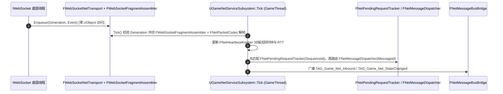

# GameNetService 架构概览与跨线程安全模型

## 1. 单一职责组件协作与跨线程隔离

1. **职责边界清晰拆分**：
   - `FWebSocketFragmentAssembler` 仅负责二进制分片缓冲与最大帧长拦截；
   - `FWebSocketNetTransport` 仅负责 `IWebSocket` 生命周期、64 位原子 `Generation` 代际防串扰与 `MPSC` 无锁事件搬运；
   - `FNetTransportFactory` 负责具体传输实例创建，使 `UGameNetServiceSubsystem` 仅面向抽象 `INetTransport` 编程；
   - `FNetPendingRequestTracker` 与 `FNetMessageDispatcher` 彻底分离“单次异步 RPC 序列追踪”与“常驻 `MessageId` 快照多播”；
   - `FNetMessageBusBridge` 独立封装 `UGameplayMessageSubsystem` 的监听句柄与消息广播。
2. **GameThread 唯一消费铁律**：后台 Socket 线程绝不触碰任何 `UObject`、委托或业务容器；全部解帧、反序列化、超时结算与回调触发 100% 运行在主线程。

---

## 2. 全插件统一网络接入方式

- **业务层插件 / 主工程模块**：直接依赖 `GameNetService`，包含 `System/GameNetServiceSubsystem.h`，调用 `SendStruct` / `SendStructRequest` / `RegisterStructHandler` 强类型模板接口；
- **平级通用插件**：无需依赖 `GameNetService` 或 `WebSockets`，仅依赖零物理网络的 `GameNetCore` 并包含 `Message/GameNetworkMessageTypes.h`，即可通过 `TAG_Game_Net_Outbound`、`TAG_Game_Net_Inbound` 与 `TAG_Game_Net_StateChanged` 完成跨插件收发；
- **基础设施日志联动（远程日志）**：`UGameNetServiceSubsystem` 自动监听 `TAG_Game_Log_Remote`，将 `GameLogging` 输出的 `FGameRemoteLogEntry` 打包为 `NET_MSG_REMOTE_LOG (100)` 外发，实现日志基础设施与网络传输的绝对解耦；
- **数据层云端同步联动（云存档）**：`GameData` 依赖 `GameNetService`，通过 `SendStructRequest` 调度 `NET_MSG_CLOUD_SAVE_*` (201~206) 系列消息，完成高阶分段存档的云端上传、下载与热恢复。

---

## 3. 全插件生态网络选型与边界仲裁矩阵 (Plugin Ecosystem Network Boundary)

在 `UEToolkit` 中，不同物理特性的数据（实时战斗 vs 业务大厅 vs 基础设施）由不同通道负责，严禁“一刀切”强行大一统：

| 插件模块 | 是否接入 GameNet | 网络通信底层驱动 | 架构决策依据与通信模型 |
| :--- | :---: | :--- | :--- |
| **`GameCore`** | ❌ 绝对不接 | 零网络（纯本地内存） | Layer 0 纯净底座，保持纯单机 0 平台依赖 |
| **`GameGameplayCore`** | ❌ 绝对不接 | 引擎原生 UDP 属性复制 | 战斗毫秒级数值计算；TCP/WebSocket 会因队头阻塞导致跳字与时钟失步 |
| **`GameGameplay` (GAS)** | ❌ 绝对不接 | 引擎原生 UDP / RPC | GAS 机制天然强绑定引擎底层网络驱动（UNetDriver / Iris） |
| **`GameFeedback`** | ❌ 绝对不接 | 引擎原生紧凑 UDP 派发 | 顿帧闪白走微型载荷（典型 ≤64B）广播，必须与画面渲染帧严格同步 |
| **`GameLogging`** | ✅ 旁路解耦 | `TAG_Game_Log_Remote` ➔ WebSocket | 远程日志通过消息总线无感广播，NetService 自动代理外发，日志模块自身零网络代码 |
| **`GameData`** | ✅ 门面集成 | `UGameNetServiceSubsystem` RPC | 云端存档上传/下载属于典型大厅应用层强类型 Request-Response，天然契合 WebSocket |
| **`GameNetSession`** | ✅ 组合协同 | 局域网 UDP 信标 + OSS 房间 | 会话管理与长连接网关并存，互相独立互补 |

