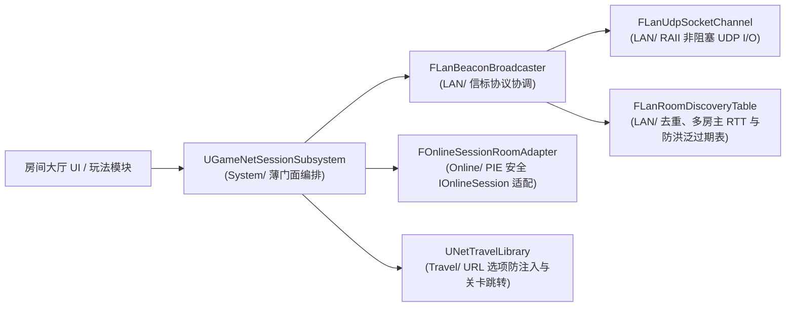

# GameNetSession 架构概览与局域网信标协议

## 1. 单一职责分层会话架构

- **局域网轨道（`LAN/`）**：将物理 Socket I/O（`FLanUdpSocketChannel`）、内存房间去重/多房主 RTT/防洪泛过期算法（`FLanRoomDiscoveryTable`）与信标报文交互协议（`FLanBeaconBroadcaster`）拆分为三个独立单职责类，使核心算法在零物理 Socket 条件下亦可高确定性单测；门面通过 `UpdateLanHostedRoom` / `BroadcastLanAnnouncement` / `WaitForLanBeaconData` 完整代理，不暴露内部成员引用。
- **平台会话轨道（`Online/OnlineSessionRoomAdapter.h`）**：独立管理 `IOnlineSession` 异步委托句柄并将 `FOnlineSessionSearchResult` 映射为纯值类型 `FGameNetRoomDescriptor`，公开头文件不暴露任何 `OnlineSubsystem` 引擎头；内置 `AliveToken` 存活守卫与历史 `BoundSessionInterface` 弱引用，确保 PIE 多实例切换或子系统析构时零悬空回调、零委托泄漏。
- **安全跳转轨道（`Travel/NetTravelLibrary.h`）**：独立提供蓝图与 C++ 共用的 Travel URL 分域词法安全校验（阻止地图路径中的 `?`/`#` 以及主机地址中的 `?`/`#`/`/`/`\` 选项注入）、URL 组装与 `ServerTravel` / `ClientTravel` 执行能力，错误统一归口至 `Game::NetErrorCodes`。

> 模块诊断日志统一经 `GameLogging` 输出至 `LogGameNetSession` 分类，并在高频报文/数据报异常路径上启用 `GAME_LOG_THROTTLE` 限频防刷屏。

---

## 2. 局域网 UDP 信标交互与安全边界

1. **复用 `FNetPacketCodec` 16 字节线格式与预缓存 JSON 负载**：所有局域网 UDP 数据报均经 `FNetPacketCodec::EncodeFrameTo` / `TryDecodeHeader` 编码 `0x5545` 魔数与精确负载长度声明，单包上限钳制为 `4096` 字节；房主在 `StartHosting` / `UpdateHostedRoom` 时预编码紧凑 JSON 负载并缓存在 `CachedHostedRoomPayload`，后续探测应答与主动宣告零重复反射直接成帧；任何长度截断、魔数不符或 JSON 损坏的杂包均在入口直接丢弃。
2. **多房主共享广播探测零时钟同步 RTT 测算**：`FLanRoomDiscoveryTable` 在发出 `LAN_DISCOVERY_PROBE_MSG_ID` 时分配递增 `SequenceId` 并记录本地单调时钟发送时刻；局域网内多台房主回显同一广播 `SequenceId` 时，发现表以非破坏性查找计算每台房主各自的往返延迟（毫秒），过期探测时间戳由周期 `PruneExpiredRooms` 与有界容量 `MAX_PENDING_PROBES (64)` 自动回收。
3. **来源 IP 安全回填、防洪泛上限与重入安全过期淘汰**：若房主未显式填写固定 `HostAddress`，`FLanRoomDiscoveryTable` 自动回填 UDP 来源 IP 并对所有字段（端口范围、玩家人数边界、主机地址防 URL 注入）进行全量校验；房间总数硬上限为 `MAX_DISCOVERED_ROOMS (256)` 防止伪造广播洪泛；超出静默窗口未刷新的房间由 `PruneExpiredRooms` 淘汰并在拷贝至局部数组后逐条触发 `OnLanRoomExpired`，允许回调内安全重入 `Stop()`。
