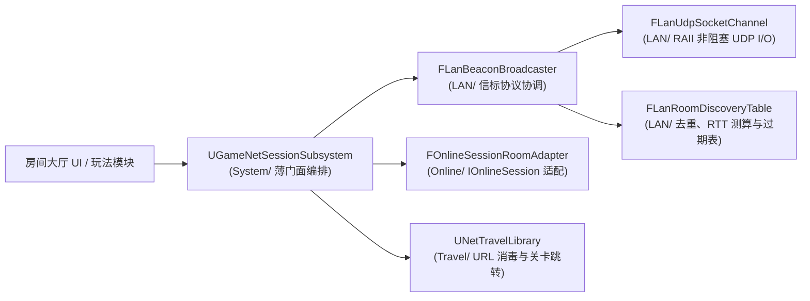

# GameNetSession 架构概览与局域网信标协议

## 1. 单一职责分层会话架构

- **局域网轨道（`LAN/`）**：将物理 Socket I/O（`FLanUdpSocketChannel`）、内存房间去重/RTT/过期算法（`FLanRoomDiscoveryTable`）与信标报文交互协议（`FLanBeaconBroadcaster`）拆分为三个独立单职责类，使核心算法在零物理 Socket 条件下亦可高确定性单测。
- **平台会话轨道（`Online/OnlineSessionRoomAdapter.h`）**：独立管理 `IOnlineSession` 异步委托句柄并将 `FOnlineSessionSearchResult` 映射为纯值类型 `FGameNetRoomDescriptor`，公开头文件不暴露任何 `OnlineSubsystem` 引擎头。
- **安全跳转轨道（`Travel/NetTravelLibrary.h`）**：独立提供蓝图与 C++ 共用的 Travel URL 词法安全校验、构建与 `ServerTravel` / `ClientTravel` 执行能力。

---

## 2. 局域网 UDP 信标交互与安全边界

1. **复用 `FNetPacketCodec` 16 字节线格式**：所有局域网 UDP 数据报均经 `FNetPacketCodec` 编码 `0x5545` 魔数与精确负载长度声明，单包上限钳制为 `4096` 字节；任何长度截断、魔数不符或 JSON 损坏的杂包均在入口直接丢弃。
2. **零时钟同步 RTT 测算**：`FLanRoomDiscoveryTable` 在发出 `LAN_DISCOVERY_PROBE_MSG_ID` 时分配递增 `SequenceId` 并记录本地单调时钟发送时刻；房主在 `LAN_ROOM_ANNOUNCE_MSG_ID` 回包中原样回显该 `SequenceId`，客户端无需与房主对时即可算出真实往返延迟（毫秒）。
3. **自动回填发送方 IP 与过期淘汰**：若房主未显式填写固定 `HostAddress`，`FLanBeaconBroadcaster` 直接提取 UDP 数据报来源 IP（`FLanReceivedDatagram::SenderIp`）填入 `FGameNetRoomDescriptor::HostAddress`，可直接传入 `UNetTravelLibrary` 或 `UGameNetSessionSubsystem::TravelToRoom` 完成连接；超出静默窗口未刷新的房间由 `FLanRoomDiscoveryTable::PruneExpiredRooms` 淘汰并触发 `OnLanRoomExpired`。
