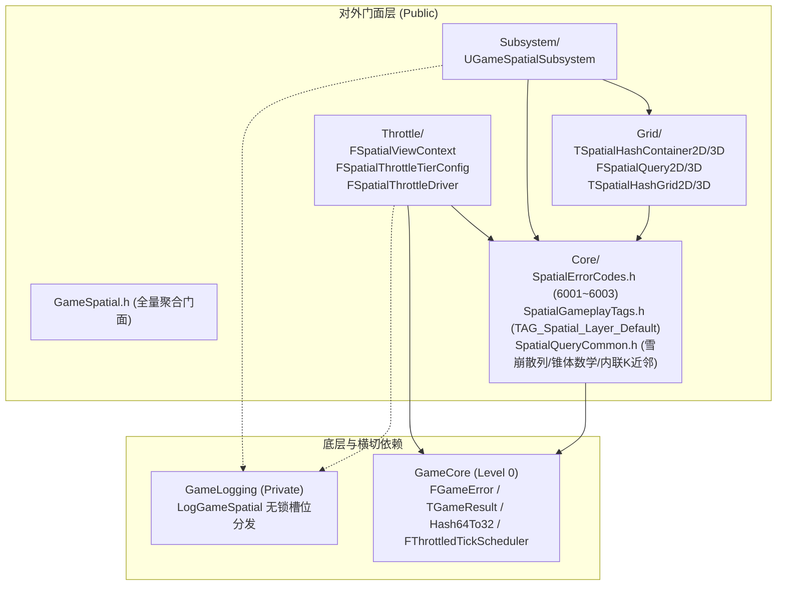

# GameSpatial 架构概述与核心机制

**版本**: 2.0.0  
**定位**: Level 1 基础设施通用插件（纯逻辑 2D/3D 均匀空间哈希网格、无物理引擎 Actor 分层空间索引子系统与视锥重要度心跳节流驱动器）  
**依赖关系**: 公开依赖 `GameCore` + UE 原生基础模块（`Core` / `CoreUObject` / `Engine` / `GameplayTags`）；私有单向依赖 `GameLogging`（`LogGameSpatial`）；严格遵守 [PluginDependencyMatrix.md](../../../GameCore/Docs/Architecture/PluginDependencyMatrix.md)，**零 `GamePool` 或横向 Level 1 依赖**。

---

## 一、 物理分层与组件拓扑

---

## 二、 五大关键工程设计

### 1. 雪崩散列与全 O(1) 底层桶维护 (`TSpatialHashContainer2D/3D`)
- **抗碰撞 64→32 雪崩散列**：复用 `GameCore::Game::Hash::Hash64To32`（MurmurHash3 64-bit Finalizer）定制 `TSpatialCellKeyFuncs`，彻底消除 UE 默认 `GetTypeHash(uint64)` 在 3D 平面地图（`CellZ == 0`）上的单桶哈希碰撞退化，确保平面与立体世界均为稳定 O(1) 查桶。
- **O(1) 同桶更新与移除**：`FElementRecord` 双向维护 `CellKey` 与 `BucketIndex`。同格位移直接按索引原地覆盖坐标；跨格迁移与移除通过尾部交换弹出（Swap-Pop）并同步回写被换入元素的 `BucketIndex`，彻底消除高密度同桶场景的 O(BucketSize) 线性扫描。
- **UE5 LWC 全双精度映射与边界钳制**：内部统一以 `double InvCellSize` 计算格坐标并通过 `FloorToClampedCellCoord` 钳制至安全区间（2D 为 `[MIN_int32 + 1, MAX_int32 - 1]` 杜绝 `++X` 溢出，3D 为 21 位有符号偏置位压缩，默认 500cm 边长下覆盖 ±524km），且 `Get1DMinDistanceToCell` 对钳制边界格外侧距离返回 `0.0`，杜绝跨格假阴性漏检与大半径整数溢出。

### 2. 紧致几何剪枝、无开方求交与稀疏快路径 (`FSpatialQuery2D/3D`)
- **精确紧致锥体/扇形包围盒**：通过 `ComputeAxisConeExtent` 解析计算 2D 扇形与 3D 球冠锥体沿各坐标轴的精确最小/最大偏移（同时支持锐角与钝角），在窄角视锥查询下直接剔除 50% ~ 87.5% 的外接球无效单元格。
- **零开方角判别**：`IsWithinConeAngle` 以点积平方比较替代逐元素 `Sqrt` 与向量除法，零误差兼容 45°/90° 精确边界与顶点重合场景。
- **稀疏大半径自动切换快路径**：当查询包围盒覆盖格数超过当前容器活跃元素总数时（如稀疏地图大半径检索），自动无溢出切换为 `ForEachElement` 线性直扫，杜绝超大半径导致的主线程卡顿。
- **栈内联零重分配 K 近邻 (`TSpatialKNearestBuffer<T, 16>`)**：`K <= 16` 时全程栈上内联零堆分配，原地移位维护升序缓冲并支持稀疏回退就地 `Reset()` 复用，永不触发 `K + 1` 扩容与 `Pop` 回缩抖动；并将距离平方校验前置于用户谓词，短路 90%+ 无效候选。

### 3. 组合封装与收敛门面 (`TSpatialHashGrid2D/3D`)
- 门面模板采用**组合**持有底层容器，屏蔽 `PackCellKey`、`ForEachCellInBox`、`ComputeCellCoord` 等底层细节；
- 统一以默认模板谓词 `FAcceptAllPredicate`（编译期零开销短路）配合完美转发，取代传统“有/无谓词双份重载”，将接口数量减半且零调用点负担；
- 统一提供零开销 `FindLocation` 只读探查与 `Query*Matching` 零堆分配流式原语。

### 4. 世界级分层空间子系统 (`UGameSpatialSubsystem`)
- **静态原生默认标签**：通过 `UE_DEFINE_GAMEPLAY_TAG_COMMENT(TAG_Spatial_Layer_Default, "Spatial.Layer.Default", ...)` 在模块加载期静态注册，杜绝运行期懒注册风险。
- **不可变对象键防悬垂与状态一致**：内部统一采用 `TObjectKey<AActor>`（不可变弱身份键，彻底免疫已销毁 `TWeakObjectPtr::operator==` 哈希桶碰撞误删）；通过 `ResolveOperationalActor` 统一校验 `ResolveObjectPtr()` 与 `!IsActorBeingDestroyed()`，即使在 `OnDestroyed` / `EndPlay` 销毁回调窗口期内，全部几何检索、只读探查与惰性清理也保持 100% 状态一致，同时放行 `UnregisterActor` 以支持 `EndPlay` 清理。
- **O(LayerSize) 精准清理与零中间数组查询**：`ClearLayer` / `PruneStaleActors` 仅遍历目标图层；`GetActorsInLayer` 与 `QueryKNearestActors` 分别复用 `ForEachElement` 与 `QueryKNearestMatching`，消除中间弱指针数组堆分配；并向 C++ 暴露 `ForEachActorIn*` 流式遍历原语。

### 5. 视锥节流驱动器 (`FSpatialThrottleDriver`)
- **双上限、零开方视锥与双向迟滞带**：最大有效距离严格取 `Min(Config.DistanceFar, ViewContext.MaxDistance)`，复用 `IsWithinConeAngle` 与距离平方阈值消除热循环全部 `Sqrt` 与除法（精确兼容 `45°` / `90°` / `360°` 边界），配合距离与角度双向迟滞带消除边界乒乓跳频；对负视距、零朝向与非有限坐标安全降级为 `OutOfRange`。
- **零热路径拷贝与 O(1) 句柄管理**：引入与 `GameCore::FThrottledTickScheduler` 一致的 `PendingAdditions` 重入队列，评估循环期间锁死 `Entities` 拓扑、零 `TFunction` 拷贝；通过 `HandleToIndex` 哈希索引使 `UnregisterSpatialEntity`、`SetEntitySignificance` 与 `IsEntityRegistered` 全部达到 O(1)。
- **日志分级纪律 (`LogGameSpatial`)**：`StartupModule`/`ShutdownModule` 输出 `Log`；子系统销毁失效、递归重入或非法视图参数输出限频/单次 `Warning`；注册拒绝与惰性清理计数输出 `Verbose`；高频查询与坐标更新热路径绝对零日志。
