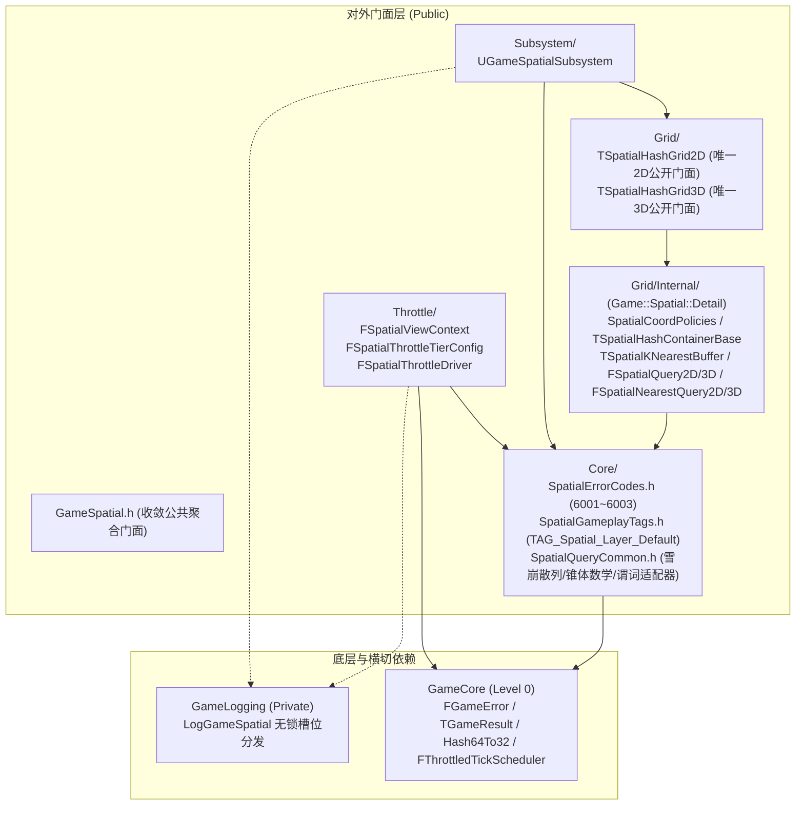

# GameSpatial 架构概述与核心机制

**版本**: 2.0.0  
**定位**: Level 1 基础设施通用插件（纯逻辑 2D/3D 均匀空间哈希网格、无物理引擎 Actor 分层空间索引子系统与视锥重要度心跳节流驱动器）  
**依赖关系**: 公开依赖 `GameCore` + UE 原生基础模块（`Core` / `CoreUObject` / `Engine` / `GameplayTags`）；私有单向依赖 `GameLogging`（`LogGameSpatial`）；严格遵守 [PluginDependencyMatrix.md](../../../GameCore/Docs/Architecture/PluginDependencyMatrix.md)，**零 `GamePool` 或横向 Level 1 依赖**。

---

## 一、 物理分层与组件拓扑

---

## 二、 五大关键工程设计

### 1. 共享底层容器、雪崩散列与单次探查维护 (`Grid/Internal/TSpatialHashContainerBase.h`)
- **2D/3D 共享泛型核心**：通过策略模式（`FSpatialCoordPolicy2D` / `FSpatialCoordPolicy3D`）驱动唯一容器模板 `TSpatialHashContainerBase`，消除 2D/3D 间 250+ 行重复维护逻辑；内部细节全部收拢至 `Game::Spatial::Detail` 命名空间。
- **抗碰撞 64→32 雪崩散列**：复用 `Game::Hash::Hash64To32`（MurmurHash3 64-bit Finalizer）定制 `TSpatialCellKeyFuncs`，彻底消除 UE 默认 `GetTypeHash(uint64)` 在 3D 平面地图（`CellZ == 0`）上的单桶哈希碰撞退化。
- **单次哈希插入与全 O(1) 桶维护**：`Insert` 通过 `Elements.FindOrAdd` 单次哈希探查完成判重与槽位写入；`FElementRecord` 双向维护 `CellKey` 与 `BucketIndex`，同格原地直写、跨格迁移与移除采用 O(1) Swap-Pop 并自动回收空桶；额外提供 `ForEachElementExcludingCell` 供稀疏回退跳过中心格。
- **UE5 LWC 全双精度映射与边界钳制**：内部统一以 `double InvCellSize` 计算格坐标并通过 `FloorToClampedCellCoord` 钳制至安全区间（2D 为 `[MIN_int32 + 1, MAX_int32 - 1]` 杜绝 `++X` 溢出，3D 为 21 位有符号偏置位压缩，默认 500cm 边长下覆盖 ±5,242km）。

### 2. 紧致几何剪枝、无开方求交与自适应向外壳层近邻 (`FSpatialQuery2D/3D.h` + `FSpatialNearestQuery2D/3D.h`)
- **范围与近邻职责分离**：`FSpatialQuery2D/3D` 专注几何范围求交（圆/球、AABB、圆柱、扇形/锥体），`FSpatialNearestQuery2D/3D` 专注向外壳层近邻与 K 近邻，确保各内部头文件职责单一、参数精简且易维护。
- **精确紧致锥体/扇形包围盒**：通过 `ComputeAxisConeExtent` 解析计算 2D 扇形与 3D 球冠锥体沿各坐标轴的精确最小/最大偏移（同时支持锐角与钝角），在窄角视锥查询下直接剔除 50% ~ 87.5% 的外接球无效单元格。
- **零开方角判别（含 90° 斜向法平面容差）**：`IsWithinConeAngle` 以点积平方比较替代逐元素 `Sqrt` 与向量除法，对锐角、精确 90° 斜向法平面与钝角边界均具一致浮点容差。
- **中心格快路径 + 自适应切比雪夫壳层扩展 + 零浮点位解包稀疏回退**：`QueryNearest` 与 `QueryKNearestMatching` 优先在中心格收敛，若命中已严格落于中心格安全边距内则零开方直接早退；否则逐圈向外扩展并在 `MinFaceDist^2 > MaxValidDistSq` 时立即终止（3D K=5 实测见 README 性能基准表，提速约 4×）；当加权壳层探查成本超过元素线性扫描时无缝切入稀疏回退，对空壳层零过滤直扫、对已访壳层利用缓存 `CellKey` 零浮点位解包精确去重（3D 稀疏超大半径实测见 README 性能基准表，同时保证有状态 `mutable` 谓词对每个元素至多求值一次）。
- **独立栈内联零重分配 K 近邻 (`Grid/Internal/TSpatialKNearestBuffer.h`)**：`K <= 16` 时全程栈上内联零堆分配，按实际命中数精准预留输出数组，并将距离平方校验前置于用户谓词。

### 3. 收敛门面封装 (`TSpatialHashGrid2D/3D`)
- `TSpatialHashGrid2D/3D` 与 `GameSpatial.h` 对外仅暴露统一网格门面，彻底屏蔽 `PackCellKey`、`ComputeCellCoord`、`FBucketEntry` 等内部零件；
- 统一以默认模板谓词 `FAcceptAllPredicate`（编译期零开销短路）配合完美转发，取代“有/无谓词双份重载”，并提供 `IsEmpty()`、`FindLocation()` 与 `Query*Matching` 流式原语。

### 4. 世界级分层空间子系统 (`UGameSpatialSubsystem`)
- **静态原生默认标签**：通过 `UE_DEFINE_GAMEPLAY_TAG_COMMENT(TAG_Spatial_Layer_Default, "Spatial.Layer.Default", ...)` 在模块加载期静态注册，杜绝运行期懒注册风险。
- **不可变对象键、单次探查注册与静止早退**：内部统一采用 `TObjectKey<AActor>`（免疫已销毁弱指针哈希桶碰撞误删）；`RegisterActor` 采用 `TrackedActors.FindOrAdd` 单次哈希探查完成查重与写入，`UpdateActorLocation` 与同层重注册对静止坐标直接早退（实测见 README 性能基准表，省去图层与网格双重查找）；销毁窗口期内全部查询、探查与清理 100% 一致，同时放行 `UnregisterActor` 支持 `EndPlay`。
- **O(LayerSize) 精准清理与零中间数组查询**：`ClearLayer` / `PruneStaleActors` 仅遍历目标图层；`GetActorsInLayer` 与 `QueryKNearestActors` 复用流式原语消除中间弱指针数组堆分配并对 `K` 预留做安全封顶；4 类 `ForEachActorIn*` 通过统一私有适配器零分配暴露给 C++。

### 5. 视锥节流驱动器 (`FSpatialThrottleDriver`)
- **每帧查表预计算、双上限与双向迟滞带**：最大有效距离严格取 `Min(Config.DistanceFar, ViewContext.MaxDistance)`；将预计算参数包与内联档位评估函数完全收敛于 `.cpp` 匿名命名空间（零公共头泄漏与零跨平台导出冲突），每帧一次性预计算四档距离迟滞阈值平方查表（`NearThresholdSq[4]` / `MidThresholdSq[4]` / `MaxDistEnterSq` / `MaxDistKeepSq`），500 实体稳态评估实测见 README 性能基准表。
- **零热路径拷贝与重入队列**：引入与 `FThrottledTickScheduler` 一致的 `PendingAdditions` 重入队列，评估循环期间锁死 `Entities` 拓扑、零 `TFunction` 拷贝；通过 `HandleToIndex` 实现驱动器侧 O(1) 注销、重要度切换与注册态查询。
- **日志分级纪律 (`LogGameSpatial`)**：`StartupModule`/`ShutdownModule` 输出 `Log`；子系统销毁失效、递归重入、非法视图或非法注册坐标输出单次/限频 `Warning`；注册拒绝与惰性清理计数输出 `Verbose`；高频查询与坐标更新热路径绝对零日志。
