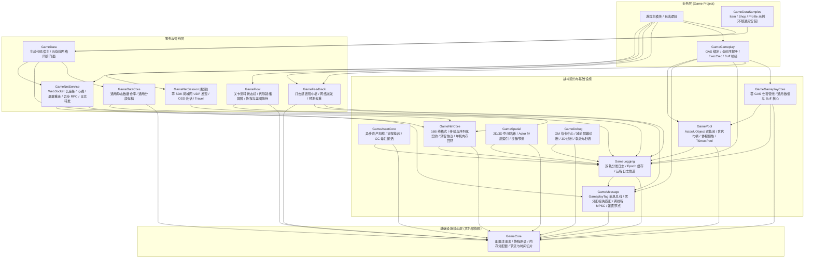

# UEToolkit

[](https://www.unrealengine.com/)
[](https://en.cppreference.com/w/cpp/20)
[]()
[]()

**UEToolkit** 是面向 **Unreal Engine 5.1 ~ 5.8** 的通用模块化插件套件、工程规范体系与跨平台自动化工具链。16 个插件按 **Level 0 ~ 3** 单向分层，可单独引入，也可一键安装到任意 UE5 工程。

## 30 秒了解

- **它解决什么**：把配置、日志、消息总线、对象池、空间索引、数值 / Buff、GAS 绑定、打击感、关卡流转、配表存档、网络长连接等通用能力，拆成互不循环依赖的独立插件。
- **核心差异**：`GameCore` 零插件依赖；Level 0 ~ 3 单向分层；核心模块自带 Automation 测试与性能预算；文档由 `verify_docs.py` 按源码事实校验。
- **最快接入**：`curl -fsSL .../install.sh | bash -s -- --all .`，或本地 `./.scripts/install.sh --all /path/to/Project`。
- **阅读顺序**：下面的「插件选择」→ 目标插件 `README.md` → `Docs/Architecture/Overview.md` → `Docs/API/`。

## 我该选哪个插件？

| 你的需求 | 推荐入口 | 备注 |
| :--- | :--- | :--- |
| 配置注册表、确定性随机、协程、容器、状态机 | [GameCore](Plugins/GameCore/README.md) | 其他插件的共同底座，零插件依赖 |
| 模块间解耦通信、跨线程消息 | [GameMessage](Plugins/GameMessage/README.md) | `GameplayTag` 寻址 + `UScriptStruct` 类型校验 |
| 统一日志分类、限频、远程日志 | [GameLogging](Plugins/GameLogging/README.md) | 私有依赖 GameMessage |
| Actor / UObject 对象池、结构体内存池 | [GamePool](Plugins/GamePool/README.md) | 世代句柄防悬空；支持池化预热 |
| 2D / 3D 空间查询、视锥节流 | [GameSpatial](Plugins/GameSpatial/README.md) | 不依赖物理引擎 |
| GM 指令、屏幕诊断、3D 绘制、耗时秒表 | [GameDebug](Plugins/GameDebug/README.md) | Shipping 下零开销裁剪 |
| 异步加载资产并保持常驻 | [GameAssetCore](Plugins/GameAssetCore/README.md) | 流式加载 + 协程 + GC 保活 |
| 不依赖 GAS 的数值 / Buff / 伤害契约 | [GameGameplayCore](Plugins/GameGameplayCore/README.md) | 可直接用于原生 Pawn 或 ECS |
| GAS 绑定、属性集、ExecCalc、Cue 桥接 | [GameGameplay](Plugins/GameGameplay/README.md) | 业务层，公开依赖 GameFeedback |
| 打击感、顿帧、震屏、受击闪白、网络表现 | [GameFeedback](Plugins/GameFeedback/README.md) | 消息总线 + 独立能力组件 |
| 关卡流转、加载进度、就绪屏障 | [GameFlow](Plugins/GameFlow/README.md) | 三态流转 + 协程 / 蓝图等待 |
| Excel 配表、静态数据、分段存档、云存档 | [GameData](Plugins/GameData/README.md) | 含 GameDataCore 通用数据模块 |
| WebSocket 长连接、心跳、重连、RPC | [GameNetService](Plugins/GameNetService/README.md) | 含 GameNetCore 线格式与传输契约 |
| 局域网房间发现、OSS 会话、Travel 握手 | [GameNetSession](Plugins/GameNetSession/README.md) | 按需引入，纯单机项目可不装 |
| 查看生成管线与存档适配示例 | [GameDataSamples](Plugins/GameDataSamples/README.md) | 示例插件，`install.sh --all` 默认跳过 |

## 插件一览

| 层级 | 插件 | 一句话 | 直接依赖 |
| :---: | :--- | :--- | :--- |
| 0 | [GameCore](Plugins/GameCore/README.md) | 配置、随机、协程、容器、事件、内存与调度底座 | 无 |
| 1 | [GameMessage](Plugins/GameMessage/README.md) | `GameplayTag` 消息总线与蓝图异步节点 | GameCore |
| 1 | [GameLogging](Plugins/GameLogging/README.md) | 日志分类、双轨分发与远程日志管道 | GameCore, GameMessage |
| 1 | [GamePool](Plugins/GamePool/README.md) | Actor / UObject 双轨对象池与 `TStructPool` | GameCore, GameLogging |
| 1 | [GameSpatial](Plugins/GameSpatial/README.md) | 纯逻辑 2D/3D 空间哈希与视锥节流 | GameCore, GameLogging |
| 1 | [GameDebug](Plugins/GameDebug/README.md) | GM 指令、屏幕诊断、3D 绘制与耗时秒表 | GameCore, GameLogging |
| 1 | [GameAssetCore](Plugins/GameAssetCore/README.md) | 异步资产加载、协程挂起与 GC 常驻保活 | GameCore, GameLogging |
| 1 | [GameGameplayCore](Plugins/GameGameplayCore/README.md) | 零 GAS 伤害管线、数值、生命与 Buff 核心 | GameCore, GamePool, GameLogging |
| 1 | [GameNetCore](Plugins/GameNetCore/README.md) | 16B 线格式、传输 / 序列化契约、内存回环 | GameCore, GameLogging |
| 2 | [GameFeedback](Plugins/GameFeedback/README.md) | 打击感表现中枢、分层时间膨胀与网络派发 | GameCore, GameMessage, GameLogging, Niagara |
| 2 | [GameFlow](Plugins/GameFlow/README.md) | 关卡流转状态机、代际就绪屏障与协程等待 | GameCore, GameLogging |
| 2 | [GameData](Plugins/GameData/README.md) | Excel 生成宿主与云存档门面（含 GameDataCore 模块） | GameCore, GameLogging, GameNetCore, GameNetService |
| 2 | [GameNetService](Plugins/GameNetService/README.md) | WebSocket 长连接、心跳、重连与异步 RPC | GameNetCore, GameCore, GameMessage, GameLogging |
| 2 | [GameNetSession](Plugins/GameNetSession/README.md) | 局域网 UDP 发现、OSS 会话与 Travel 握手 | GameNetCore, GameCore, GameLogging |
| 3 | [GameGameplay](Plugins/GameGameplay/README.md) | GAS 绑定、Bootstrap、ExecCalc 与 Cue 桥接 | GameGameplayCore, GameFeedback, GameCore, GameMessage, GamePool, GameLogging |
| 3 | [GameDataSamples](Plugins/GameDataSamples/README.md) | Item / Shop / Profile 生成与存档示例 | GameData, GameCore, GameLogging |

> 文档中的 `Layer` 与 `Level` 同义：0 = 核心底座，1 = 基础设施，2 = 领域调度，3 = 业务实现。除示例插件 `GameDataSamples` 外，各插件均提供 `Docs/` 文档库。

## 插件能力矩阵

按插件列出核心能力与关键入口；完整 API、线程与生命周期边界见各插件 `Docs/`。

| 层级 | 插件 | 核心能力 | 关键入口 |
| :---: | :--- | :--- | :--- |
| 0 | [GameCore](Plugins/GameCore/README.md) | 配置注册表 / 编译开关、确定性随机与 PRD、C++20 协程与取消、容器与内存、事件总线与观察者、缓存与调度、状态机与帧率无关数学、性能计时与服务定位 | `FConfigRegistry`、`TGameResult`、`TGameCoroTask`、`FListenerHub` |
| 1 | [GameMessage](Plugins/GameMessage/README.md) | `GameplayTag` 消息总线、祖先通道匹配、跨线程 MPSC、蓝图异步监听、RAII 订阅句柄 | `UGameplayMessageSubsystem`、`FGameplayMessageListenerHandle`、`UAsyncAction_ListenForGameplayMessage` |
| 1 | [GameLogging](Plugins/GameLogging/README.md) | 模块分类注册、双轨分发、限频与单次输出、Shipping 零开销、远程日志管道 | `GAME_REGISTER_MODULE_LOG`、`GAME_LOG_THROTTLE`、`FGameRemoteLogOutputDevice` |
| 1 | [GamePool](Plugins/GamePool/README.md) | Actor / UObject 对象池、世代安全句柄、池化预热、无锁延迟归还、`TStructPool` | `UObjectPoolSubsystem`、`TPooledObjectHandle`、`TStructPool` |
| 1 | [GameSpatial](Plugins/GameSpatial/README.md) | 2D / 3D 空间哈希、范围与近邻查询、Actor 分层索引、视锥迟滞节流 | `TSpatialHashGrid2D/3D`、`UGameSpatialSubsystem`、`FSpatialThrottleDriver` |
| 1 | [GameDebug](Plugins/GameDebug/README.md) | GM 指令注册、屏幕诊断、3D 绘制、轨迹记录、时间控制、作用域秒表 | `FGameCheatRegistry`、`FGameDebugPrint`、`FGameDebugDraw`、`FScopedDebugStopwatch` |
| 1 | [GameAssetCore](Plugins/GameAssetCore/README.md) | 异步资产加载、协程加载与取消、GC 常驻保活、蓝图异步节点 | `FGameAssetLoader`、`FGameAssetLoadHandle`、`FGameAssetPinner`、`FScopedPinnedAsset` |
| 1 | [GameGameplayCore](Plugins/GameGameplayCore/README.md) | 零 GAS 伤害契约、数值与修正器、生命状态、Buff 与叠层 | `IDamageable`、`UGameStatComponent`、`UGameVitalComponent`、`UGameBuffComponent` |
| 1 | [GameNetCore](Plugins/GameNetCore/README.md) | 16B 报文头、粘包 / 半包解帧、传输与序列化契约、单机内存回环 | `FNetPacketHeader`、`FNetPacketCodec`、`INetTransport`、`FMockNetTransport` |
| 2 | [GameFeedback](Plugins/GameFeedback/README.md) | 表现信号总线、震屏 / 顿帧 / 闪白 / VFX / 音效 / 触觉、分层时间膨胀、网络派发与预测去重 | `FGameFeedbackSignal`、`UGameFeedbackDefinition`、`UTimeDilationSubsystem`、`UGameFeedbackBlueprintLibrary` |
| 2 | [GameFlow](Plugins/GameFlow/README.md) | 三态关卡流转、加权进度与遥测、代际就绪屏障、看门狗、协程 / 蓝图等待 | `ULoadingSubsystem`、`FLoadingBarrierToken`、`GameFlow::WaitLoadingComplete`、`UAsyncAction_WaitForLoadingComplete` |
| 2 | [GameData](Plugins/GameData/README.md) | Excel 生成宿主、静态数据仓库与快照（GameDataCore）、分段存档、云存档 RPC | `UGameCloudSaveSubsystem`、`USaveGameSubsystem`、`TStaticDataSnapshotStore` |
| 2 | [GameNetService](Plugins/GameNetService/README.md) | WebSocket 长连接、心跳 RTT、退避重连、异步 RPC、消息总线桥接、远程日志转发 | `UGameNetServiceSubsystem`、`FNetReconnectPolicy`、`FNetHeartbeatKeeper`、`TNetRequestStructAwaiter` |
| 2 | [GameNetSession](Plugins/GameNetSession/README.md) | 局域网 UDP 发现、OSS 会话适配、安全 Travel | `UGameNetSessionSubsystem`、`FLanBeaconBroadcaster`、`UNetTravelLibrary` |
| 3 | [GameGameplay](Plugins/GameGameplay/README.md) | GAS ASC、Bootstrap 引导、属性集、ExecCalc、Buff / Cue 桥接、UI 属性映射 | `UGameAbilitySystemComponent`、`UGameAbilitySystemBootstrap`、`UGameDamageExecution`、`UGameplayAttributeValueMapping` |
| 3 | [GameDataSamples](Plugins/GameDataSamples/README.md) | Item / Shop 生成示例、PlayerProfile 存档适配 | `UGamePlayerDataRegistry`、`UGamePlayerProfileSaveAdapter`、`UStaticDataSubsystem` |

<details>
<summary><b>展开依赖拓扑图</b></summary>



</details>

## 快速开始

### 1. 安装

```bash
# 远程安装：无需克隆母仓，安装后自动清理临时目录
curl -fsSL https://raw.githubusercontent.com/yiice/UEToolkit/main/.scripts/install.sh | bash -s -- --all .
wget -qO- https://raw.githubusercontent.com/yiice/UEToolkit/main/.scripts/install.sh | bash -s -- GameGameplay /path/to/MyTargetProject

# 本地安装：自动补齐前置依赖；GameData 默认 copy，其余 link
./.scripts/install.sh --list
./.scripts/install.sh --all /path/to/MyTargetProject
./.scripts/install.sh GameGameplay /path/to/MyTargetProject
./.scripts/install.sh --all /path/to/MyTargetProject --mode copy   # 发布模式：全部物理拷贝

# 卸载
./.scripts/install.sh GameGameplay /path/to/MyTargetProject --uninstall --yes
```

### 2. 验收与 CI

```bash
python3 .scripts/verify_install.py --project /path/to/EmptyProject
python3 .scripts/verify_package.py --project /path/to/EmptyProject
./.scripts/ci_local.sh              # 清理进程 → 文档校验 → 编译 → 自动化测试 → 网络冒烟
./.scripts/ci_local.sh --skip-build # 复用已有二进制
```

- 自动化覆盖 `Game.Core` / `Game.Data` / `Game.Debug` / `Game.Flow` / `Game.Gameplay` / `Game.GameplayCore` / `Game.Logging` / `Game.Message` / `Game.Feedback` / `Game.Net` / `Game.Pool` / `Game.Spatial` 十二个前缀；
- 网络冒烟以 `-nullrhi` 起监听服务端与客户端，服务端施加带状态标签的 Buff，客户端确认标签复制到达后写 `Saved/NetSmoke/ClientResult.txt`；
- 全部日志与结果归档到 `.memory/baseline/<时间戳>/`。

单独跑测试：

```bash
python3 .scripts/run_automation_tests.py                     # 7 个 SRP 解耦用例
python3 .scripts/run_automation_tests.py --all               # 十三前缀全量回归
python3 .scripts/run_automation_tests.py --prefix Game.Core  # 追加前缀
python3 .scripts/run_automation_tests.py --dry-run           # 仅打印命令行
```

### 3. 工具链

```bash
./Tools/Build/update_compile_commands.sh                                      # Clangd 编译数据库
./Tools/Excel/generate_all_tables.sh --config Tools/Excel/generator_config.json --all
./Tools/Cook/run_cook_tools.sh --diff                                         # .bin / JSON 双通道对拍
```

- **`Tools/Build`**：解析 `.uproject` 生成 `compile_commands.json`，支持 rsp 与软链接兜底。
- **`Tools/Excel`**：外键校验 → 生成 RowStruct / 容器 / 查询服务 / 序列化器 → 导出 JSON → 写前快照回滚。
- **`Tools/Cook`**：打包产物双通道一致性对拍与无头冷启动反序列化基准。
- **`Tools/Script`**：约定优于配置的路径推导与共享基础设施。

## 工程结构

<details>
<summary><b>展开目录树</b></summary>

```text
UEToolkit/
├── Plugins/                         # 模块化插件集合
│   ├── GameCore/                    # [Layer 0] 通用基础设施 (零外部依赖)
│   ├── GameAssetCore/               # [Layer 1] 异步资产加载 / 协程挂起 / GC 常驻保活
│   ├── GameMessage/                 # [Layer 1] GameplayTag 消息总线与蓝图异步节点
│   ├── GameLogging/                 # [Layer 1] 全局日志分发与远程日志管道
│   ├── GamePool/                    # [Layer 1] Actor/UObject 对象池与原生结构体内存池
│   ├── GameSpatial/                 # [Layer 1] 纯逻辑 2D/3D 空间哈希网格、Actor 分层子系统与视锥节流
│   ├── GameDebug/                   # [Layer 1] GM 指令中心、域盐屏幕诊断、3D 绘制、O(1) 轨迹、时间控制器与观察中心
│   ├── GameGameplayCore/            # [Layer 1] 战斗契约 / 通用数值与 Buff
│   ├── GameGameplay/                # [Layer 3] GAS 业务绑定与引导组件
│   ├── GameFeedback/                # [Layer 2] 打击感表现中枢 / 网络派发
│   ├── GameFlow/                    # [Layer 2] 关卡流转状态机、代际就绪屏障与协程/蓝图等待原语
│   ├── GameData/                    # [Layer 2] GameDataCore + 生成宿主双模块
│   ├── GameDataSamples/             # [Layer 3] 示例域与 Profile 适配器（不随通用安装）
│   ├── GameNetCore/                 # [Layer 1] 网络报文头契约 / 序列化器 / 单机内存回环
│   ├── GameNetService/              # [Layer 2] WebSocket 长连接 / 心跳 / 退避重连 / 异步 RPC
│   └── GameNetSession/              # [Layer 2] 零 SDK 局域网 UDP 发现 / OSS 会话 / Travel 握手
├── Tools/                           # 跨平台自动化工具链
│   ├── Build/                       # Clangd 编译数据库生成
│   ├── Cook/                        # CI 对拍与冷启动基准
│   ├── Excel/                       # 数据表生成器
│   └── Script/                      # 共享基础脚本
├── .scripts/                        # 隐藏工程脚本集（安装/验收/打包/本地 CI）
│   ├── install.sh / .bat / .py      # 智能双模一键安装引导器（支持 curl/wget 远程安装）
│   ├── verify_install.py            # 空工程一键验收脚本
│   ├── verify_package.py            # 打包冒烟一键验收脚本
│   ├── run_automation_tests.py      # 自动化测试运行脚本（默认 7 个解耦用例）
│   ├── verify_docs.py               # 文档与源码事实一致性校验脚本
│   └── ci_local.sh                  # 本地 CI 全链路验收脚本
├── DataTables/                      # 策划 Excel 源表（示例）
├── DataTables_Json/                 # 导出的 JSON 数据（示例）
├── Source/                          # 工程主模块代码
├── UEToolkit.uproject               # UE5 工程描述文件
└── README.md                        # 本文档
```

</details>

## 工程规范

规范以 Agent Skills 形式维护于 [.agents/skills/](.agents/skills/)：

- [acs-core-workflow](.agents/skills/acs-core-workflow/SKILL.md)：B1~B8 行为宪法、五阶状态机、L3/L4 计划与根因排障
- [acs-cpp](.agents/skills/acs-cpp/SKILL.md)：类排布、RAII、零开销抽象、移动语义
- [acs-ue5](.agents/skills/acs-ue5/SKILL.md)：命名、GC、反射、网络同步与生命周期
- [acs-engineering-baseline](.agents/skills/acs-engineering-baseline/SKILL.md)：架构原则、API 契约、测试与可观测性
- [acs-code-review](.agents/skills/acs-code-review/SKILL.md)：五阶审查流水线与严重度分级
- [acs-git-docs](.agents/skills/acs-git-docs/SKILL.md)：分支流、提交格式、文档与 ADR 治理

## 版本与兼容

- **引擎**：Unreal Engine 5.1 ~ 5.8（当前 CI 基线为 5.8；更低至 5.1 的版本由安装脚本版本门禁放行，尚未纳入多版本 CI）。
- **编译器**：Clang 15+ / MSVC 2022 (v143) / GCC 12+，强制 C++20。
- **Python**：3.8+；工具链依赖 `pip install -r Tools/requirements.txt`。
- **插件版本**：以各插件 `.uplugin` 的 `VersionName` 为准；性能预算见 [Performance.md](Plugins/GameCore/Docs/Architecture/Performance.md)。

> 文档中的性能数值均为历史 Development 构建实测参考值，测量环境见各插件 README 的性能基准章节；未纳入 CI 自动复测，不构成 Shipping 绝对性能承诺。
