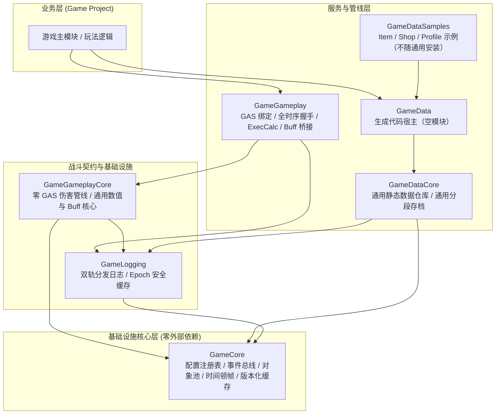

# UEToolkit

[](https://www.unrealengine.com/)
[](https://en.cppreference.com/w/cpp/20)
[]()
[]()

**UEToolkit** 是面向 **Unreal Engine 5.1 ~ 5.8** 的通用模块化插件套件、工程规范体系与跨平台自动化工具链。

本项目采用**分层解耦、零无序依赖、契约优先与配置驱动**的设计哲学。无论是从零起步的新项目，还是已有成熟的大型游戏工程，均可按需引入特定的独立插件或工具，亦可直接以 Git Submodule / 软链接模式快速挂载。

> 当前版本 **2.0.0**。旧 API 迁移见 [MIGRATION.md](MIGRATION.md)，发布检查见 [RELEASE_CHECKLIST.md](RELEASE_CHECKLIST.md)，性能预算见 [Performance.md](Plugins/GameCore/Docs/Architecture/Performance.md)。

---

## 插件生态矩阵

项目内所有插件均存放在 `Plugins/` 目录下，各插件均配备独立的 `README.md` 与分类归档的完整技术文档库 `Docs/`：



| 插件名称 | 职责定位 | 核心特性 | 依赖关系 | 文档入口 |
| :--- | :--- | :--- | :--- | :--- |
| [**GameCore**](Plugins/GameCore/README.md) | 底层基础设施 | 宏真源编译开关、读写分离配置中心、`FListenerHub`、`FObservableRegistry`（Key 订阅 + 初始回放）、`GameplayMessageSubsystem`、通用对象池、HitStop 顿帧、代际安全版本化缓存 | 零外部依赖 (仅依赖引擎基础库) | [文档中心](Plugins/GameCore/Docs/Architecture/Overview.md) |
| [**GameLogging**](Plugins/GameLogging/README.md) | 全局日志中枢 | 模块分类一键 RAII 注册、动态容量注册表、双轨分发架构、Epoch 纪元安全缓存、`GAME_LOG_THROTTLE` 限频、Shipping 零开销 | `GameCore` | [文档中心](Plugins/GameLogging/Docs/Architecture/Overview.md) |
| [**GameGameplayCore**](Plugins/GameGameplayCore/README.md) | 战斗核心契约 | 零 GAS 强依赖、`IDamageable` 泛型可受击契约、闭环同步打击反馈、通用数值 `UGameStatComponent`（Proxy 读写契约 / 修正器 / 按 Tag 订阅）、通用 Buff `UGameBuffComponent` | `GameCore`, `GameLogging` | [文档中心](Plugins/GameGameplayCore/Docs/Architecture/Overview.md) |
| [**GameGameplay**](Plugins/GameGameplay/README.md) | GAS 业务绑定 | 通用 ASC 基类、全时序自动握手 Bootstrap 组件、双轨元属性集、运行时通道 Registry 的 ExecCalc、GAS Buff 桥接、UI 属性解耦映射 | `GameGameplayCore`, `GameplayAbilities`, `GameCore`, `GameLogging` | [文档中心](Plugins/GameGameplay/Docs/Architecture/Overview.md) |
| [**GameDataCore**](Plugins/GameData/Source/GameDataCore/README.md) | 通用数据与持久化 | 二进制 `.bin` 脱机仓库（CRC32 强校验）、不可变快照与版本原子发布、通用分段存档（段注册 / 版本迁移 / 槽位白名单） | `GameCore`, `GameLogging`, `Json` | [GameData 文档](Plugins/GameData/Docs/Architecture/Overview.md) |
| [**GameData**](Plugins/GameData/README.md) | 生成代码宿主 | 由 Excel 管线写入 `Public/Generated`、`Private/Generated`，默认以 `copy` 模式安装 | `GameDataCore` | [GameData 文档](Plugins/GameData/Docs/Architecture/Overview.md) |
| [**GameDataSamples**](Plugins/GameDataSamples/README.md) | 示例插件 | Item / Shop 生成域、PlayerProfile 存档段适配器与示例测试；`install.py --all` 默认跳过 | `GameData`, `GameCore`, `GameLogging` | [README](Plugins/GameDataSamples/README.md) |

---

## 自动化工具链 (Tools)

`Tools/` 目录提供跨平台（macOS / Windows / Linux）无环境锁定的 DevOps 与代码生成工具套件（详细说明见 [Tools/README.md](Tools/README.md)）：

- **`Tools/Build`**：VSCode / Clangd 编译数据库自适应生成（解析 `.uproject`，处理 rsp 参数与软链接兜底）。
- **`Tools/Excel`**：数据表全流程代码生成管线（跨表外键校验、生成 C++ RowStruct/复合容器/查询服务/序列化器、导出 JSON 数据、写前快照回滚；运行期 `.bin` 由生成式导出命令行工具在 Cook 前确定性生成）。
- **`Tools/Cook`**：打包产物 CI 双通道一致性对拍（.bin vs JSON）与无头冷启动反序列化基准采集（取证依赖生成物的启动自检开关，不依赖启动期 `-ExecCmds` 时序）。
- **`Tools/Script`**：约定优于配置的基础设施与路径推导模块。

---

## 一键安装与验收（支持 GitHub `curl` / `wget` 远程无痕安装）

所有安装、验收与 CI 脚本均收拢于隐藏目录 `.scripts/` 下，保持工程根目录纯净。

### 1. GitHub 远程一键安装（无需克隆母仓，零残留）

在你的目标 UE5（5.1 ~ 5.8）工程根目录下直接执行：

```bash
# 使用 curl 一键安装全部通用插件与工具链（自动物理拷贝至当前工程并清理临时目录）
curl -fsSL https://raw.githubusercontent.com/yiice/UEToolkit/main/.scripts/install.sh | bash -s -- --all .

# 使用 wget 一键安装指定插件（自动递归补齐前置依赖）
wget -qO- https://raw.githubusercontent.com/yiice/UEToolkit/main/.scripts/install.sh | bash -s -- GameGameplay /path/to/MyTargetProject
```

### 2. 本地仓库安装与管理（`.scripts/install.sh`）

```bash
# 查看所有可用插件与工具链
./.scripts/install.sh --list

# 安装全部通用插件与工具链（自动补齐依赖；GameData 默认 copy，其余 link）
./.scripts/install.sh --all /path/to/MyTargetProject

# 安装单个插件（自动补齐前置依赖）
./.scripts/install.sh GameGameplay /path/to/MyTargetProject

# 发布模式：全部物理拷贝
./.scripts/install.sh --all /path/to/MyTargetProject --mode copy

# 部署 Excel 配表工具链
./.scripts/install.sh Tools/Excel /path/to/MyTargetProject --mode copy

# 安全卸载（非交互环境必须显式 --yes）
./.scripts/install.sh GameGameplay /path/to/MyTargetProject --uninstall --yes
```

### 3. 空工程与打包冒烟一键验收

空工程一键验收（安装 → 生成 → 编译 → Automation 测试 → 摘要）：

```bash
python3 .scripts/verify_install.py --project /path/to/EmptyProject
```

打包冒烟验收（安装 → 生成 → 编译 → 无头导出 `.bin` → Cook 打包 → 包内双数据目录 → 打包产物双通道对拍）：

```bash
python3 .scripts/verify_package.py --project /path/to/EmptyProject
```

Shipping 冒烟验收（打包与启动自检，日志被裁剪时以 `StaticDataVerify.txt` 报告取证）：

```bash
python3 .scripts/verify_package.py --project /path/to/EmptyProject --client-config=Shipping
```

---

## 项目工程结构

```text
UEToolkit/
├── Plugins/                         # 模块化插件集合
│   ├── GameCore/                    # [Layer 0] 通用基础设施 (零外部依赖)
│   ├── GameLogging/                 # [Layer 1] 全局日志分发
│   ├── GameGameplayCore/            # [Layer 1] 战斗契约 / 通用数值与 Buff
│   ├── GameGameplay/                # [Layer 2] GAS 业务绑定与引导组件
│   ├── GameData/                    # [Layer 2] GameDataCore + 生成宿主双模块
│   └── GameDataSamples/             # 示例域与 Profile 适配器（不随通用安装）
├── Tools/                           # 跨平台自动化工具链
│   ├── Build/                       # Clangd 编译数据库生成
│   ├── Cook/                        # CI 对拍与冷启动基准
│   ├── Excel/                       # 数据表生成器
│   └── Script/                      # 共享基础脚本
├── .scripts/                        # 隐藏工程脚本集（安装/验收/打包/本地 CI）
│   ├── install.sh / .bat / .py      # 智能双模一键安装引导器（支持 curl/wget 远程安装）
│   ├── verify_install.py            # 空工程一键验收脚本
│   ├── verify_package.py            # 打包冒烟一键验收脚本
│   └── ci_local.sh                  # 本地 CI 全链路验收脚本
├── DataTables/                      # 策划 Excel 源表（示例）
├── DataTables_Json/                 # 导出的 JSON 数据（示例）
├── Source/                          # 工程主模块代码
├── UEToolkit.uproject               # UE5 工程描述文件
└── README.md                        # 本文档
```

---

## 快速上手与验证

### 1. 环境准备
- **操作系统**：macOS (Apple Silicon / Intel) / Windows 10/11 / Linux
- **引擎版本**：**Unreal Engine 5.1 ~ 5.8**
- **编译器支持**：Clang 15+ / MSVC 2022 (v143) / GCC 12+，强制 C++20 标准。
- **Python 环境**：Python 3.8+（安装工具链依赖：`pip install -r Tools/requirements.txt`）。

### 2. 生成编译数据库 (以 VSCode + Clangd 为例)
```bash
./Tools/Build/update_compile_commands.sh
```
执行完成后，根目录下会自动生成或软链接 `compile_commands.json`，在 VSCode 中可享受毫秒级跨插件代码跳转与精准诊断。

### 3. 数据表全流程生成
```bash
./Tools/Excel/generate_all_tables.sh --config Tools/Excel/generator_config.json --all
```
自动校验 Excel 外键、生成 C++ RowStruct / 静态数据容器 / 查询代码、导出 JSON 并同步 GameplayTag 注册 ini；运行期 `.bin` 由编辑器命令导出。

### 4. 本地 CI 一键验收
```bash
./.scripts/ci_local.sh              # 清理进程 → 编译 → 五前缀自动化测试 → 网络冒烟
./.scripts/ci_local.sh --skip-build # 复用已有二进制
```
- 自动化覆盖 `Game.Core` / `Game.Data` / `Game.Gameplay` / `Game.GameplayCore` / `Game.Logging` 五个前缀；
- 网络冒烟以 `-nullrhi` 起监听服务端与客户端，服务端施加带状态标签的 Buff，客户端确认标签复制到达后写 `Saved/NetSmoke/ClientResult.txt`；
- 全部日志与结果归档到 `.memory/baseline/<时间戳>/`。

---

## 工程规范与代码标准

本项目内置了一套严谨的代码标准与团队工程规范，存放于 [guidelines/](guidelines/) 目录，为虚幻引擎工程提供高可维护性基线：
- **规范总览与导航**：[guidelines/INDEX.md](guidelines/INDEX.md)
- **现代 C++ 规范**：[20-CPP规范](guidelines/20-CPP规范/01-格式命名与注释.md)（类排布契约、RAII 智能指针、零开销抽象、移动语义）
- **UE5 引擎规范**：[30-UE5规范](guidelines/30-UE5规范/01-命名格式与注释.md)（命名法则、GC 内存管理、反射体系、网络同步与生命周期）
- **通用风格与健壮性**：[10-通用代码规范](guidelines/10-通用代码规范/01-风格命名与注释.md)（强类型安全、不可信边界校验与契约设计）
- **版本控制与协作**：[40-协作规范](guidelines/40-协作规范/01-Git协作与版本规范.md)（Git 分支流、标准提交格式、LFS 资源管理）

